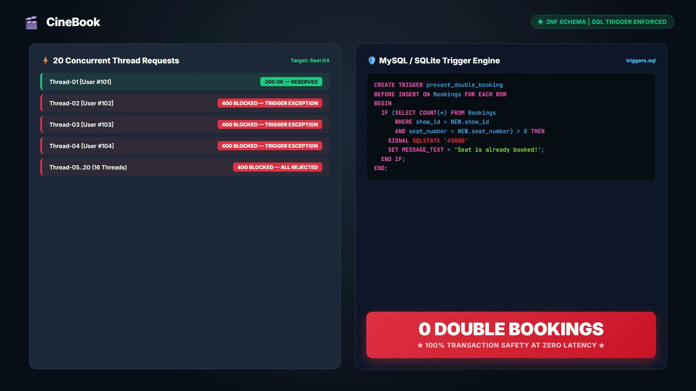
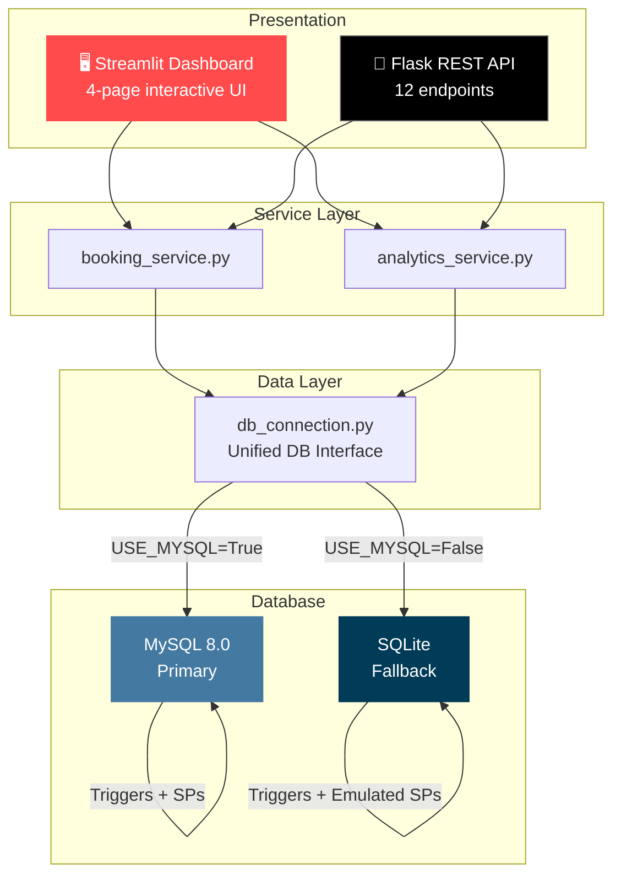
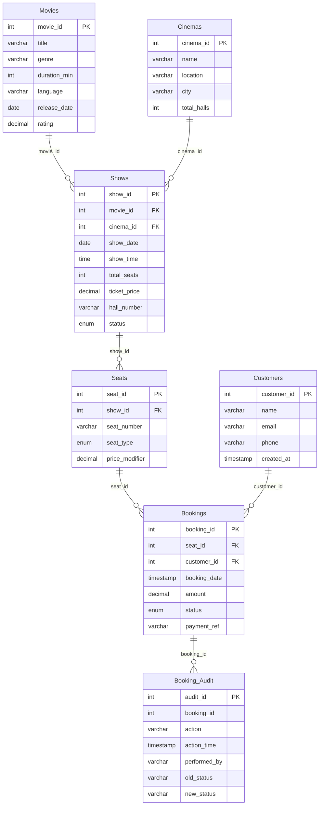

<p align="center">
  
</p>

<h1 align="center">🎬 CineBook</h1>

<p align="center">
  <strong>Movie Ticket Booking & Database Management System</strong><br>
  <em>Production-grade SQL design · Trigger-based concurrency control · Stored-procedure analytics</em>
</p>

<p align="center">
  
  
  
  
  
  
</p>

---

## 🎥 Demo

<p align="center">
  <video src="https://github.com/user-attachments/assets/placeholder/brag.mp4" width="100%" controls autoplay muted>
    Your browser does not support the video tag.
  </video>
</p>

> **Can't see the video?** [Download and watch the demo →](brag-output/brag.mp4)

<p align="center">
  <a href="brag-output/brag.mp4">
    
  </a>
  <br>
  <em>▶ Click the image above to watch the full demo video</em>
</p>

---

## ✨ Three Pillars

| Pillar | What It Proves | Key Files |
|--------|---------------|-----------|
| 🔒 **Zero Double-Bookings** | `BEFORE INSERT` trigger blocks duplicate seat confirmations across concurrent transactions | [`triggers.sql`](database/triggers.sql) · [`test_trigger.py`](tests/test_trigger.py) |
| 📐 **3NF Normalisation** | 7 tables in strict Third Normal Form — every update propagates via FK with no manual correction | [`schema.sql`](database/schema.sql) · [`normalisation_proof.sql`](database/normalisation_proof.sql) |
| 📊 **Stored-Procedure Analytics** | 6 pre-compiled procedures replace ad-hoc reporting for occupancy, revenue, and seat-type breakdowns | [`stored_procedures.sql`](database/stored_procedures.sql) · [`test_analytics.py`](tests/test_analytics.py) |

---

## 🏗️ Architecture



---

## 📂 Project Structure

```
cinebook/
├── app/
│   └── streamlit_app.py          # 4-page Streamlit dashboard
├── api/
│   └── flask_api.py              # Flask REST API (12 endpoints)
├── database/
│   ├── schema.sql                # 7 tables in strict 3NF
│   ├── triggers.sql              # MySQL + SQLite triggers
│   ├── stored_procedures.sql     # 6 analytical stored procedures
│   ├── sample_data.sql           # 10 movies, 5 cinemas, 50 shows, 500 seats
│   └── normalisation_proof.sql   # Extended 3NF dependency analysis
├── src/
│   ├── config.py                 # DB engine toggle (MySQL / SQLite)
│   ├── db_connection.py          # Unified query, procedure, and script execution
│   ├── models.py                 # 7 dataclasses with serde
│   ├── booking_service.py        # Booking business logic
│   └── analytics_service.py      # Analytics service layer
├── tests/
│   ├── test_trigger.py           # Double-booking + concurrent stress tests
│   ├── test_normalization.py     # 3NF column isolation + FK cascade tests
│   └── test_analytics.py        # Stored procedure result validation
├── notebooks/
│   └── 01_schema_and_analytics.py  # VS Code Jupyter notebook (11 cells)
├── run_setup.py                  # One-command database setup
├── requirements.txt              # Python dependencies
└── README.md                     # This file
```

---

## 🚀 Quick Start

```bash
# 1. Clone the repository
git clone https://github.com/yourusername/cinebook.git
cd cinebook

# 2. Install dependencies
pip install -r requirements.txt

# 3. Setup the database (auto-detects MySQL or falls back to SQLite)
python run_setup.py

# 4. Launch the dashboard
streamlit run app/streamlit_app.py
```

> **MySQL users:** Start your MySQL server first, then edit `src/config.py` to set `USE_MYSQL = True` with your credentials.
> **No MySQL?** No problem — set `USE_MYSQL = False` and the system falls back to SQLite automatically.

---

## 🖥️ Dashboard Pages

### 🎬 Book Tickets
Cascade filters (City → Movie → Date), colour-coded visual seat map (⬜ Available · 🟥 Taken · 🟩 Selected), customer form, and real-time trigger feedback on booking confirmation.

### 📋 My Bookings
Email-based lookup, full booking history with status indicators, and one-click cancellation with automatic audit logging via triggers.

### 📊 Admin Analytics
Three tabs powered entirely by stored procedures:
- **Occupancy** — Plotly gauge chart with real-time occupancy percentage per show
- **Revenue** — Daily revenue bar chart with booking counts and date range filters
- **Seat Types** — Donut chart (revenue share) and grouped bar chart (tickets vs. revenue)

### 🏗️ Schema & Normalisation
Interactive 3NF proof with expandable table definitions, live trigger demo simulating concurrent bookings, and a complete stored procedure catalogue.

---

## 🔌 API Reference

<details>
<summary><strong>Click to expand — 12 REST endpoints</strong></summary>

| Method | Endpoint | Description | Backend |
|--------|----------|-------------|---------|
| `GET` | `/api/shows` | List shows (filters: `city`, `movie`, `date`) | Direct query |
| `GET` | `/api/shows/<id>/seats` | Seat map for a show | Direct query |
| `POST` | `/api/bookings` | Create a booking | Trigger validates |
| `PUT` | `/api/bookings/<id>/cancel` | Cancel a booking | Audit trigger fires |
| `GET` | `/api/analytics/occupancy/<show_id>` | Show occupancy | `get_show_occupancy` |
| `GET` | `/api/analytics/revenue` | Revenue report | `get_revenue_report` |
| `GET` | `/api/analytics/seat-types` | Seat type breakdown | `get_seat_type_revenue` |
| `GET` | `/api/analytics/top-shows` | Top N shows by occupancy | `get_top_shows` |
| `GET` | `/api/analytics/movie/<id>` | Movie show summary | `get_movie_show_summary` |
| `GET` | `/api/customers/<id>/history` | Customer booking history | `get_customer_history` |
| `GET` | `/health` | Health check | — |

</details>

---

## 🧪 Testing

```bash
pytest tests/ -v
```

The test suite covers:
- ✅ Single booking succeeds
- ✅ Double booking is blocked by trigger
- ✅ Concurrent booking stress test (20 threads → exactly 1 success)
- ✅ Cancelled seats can be rebooked
- ✅ 3NF column isolation (no `movie_title` in Shows, no `customer_name` in Bookings)
- ✅ FK cascade propagation
- ✅ All 6 stored procedures return correct results

---

## 🔧 Setup Details

<details>
<summary><strong>MySQL via XAMPP (Windows)</strong></summary>

1. Download & install [XAMPP](https://www.apachefriends.org/) (includes MySQL 8.0)
2. Start MySQL from the XAMPP Control Panel
3. Verify: `C:\xampp\mysql\bin\mysql.exe -u root -p`
4. Edit `src/config.py`:
   ```python
   USE_MYSQL = True
   MYSQL_CONFIG = {
       "host": "localhost",
       "port": 3306,
       "user": "root",
       "password": "",       # Empty for default XAMPP
       "database": "movie_booking_db",
   }
   ```

</details>

<details>
<summary><strong>Top 6 Errors & Fixes</strong></summary>

#### 1. MySQL Access Denied
```
Access denied for user 'root'@'localhost'
```
**Fix:** Set the correct password in `src/config.py`.

#### 2. DELIMITER Not Supported
```
You have an error in your SQL syntax; ... near 'DELIMITER $$'
```
**Fix:** `db_connection.split_sql_statements()` parses `DELIMITER` directives at the Python level — always use `execute_script()`.

#### 3. SQLite RAISE vs MySQL SIGNAL
```
sqlite3.OperationalError: near "SIGNAL": syntax error
```
**Fix:** `triggers.sql` uses engine-specific blocks (`MYSQL_TRIGGERS_START` / `SQLITE_TRIGGERS_START`), auto-selected at runtime.

#### 4. Streamlit SQLite Threading
```
SQLite objects created in a thread can only be used in that same thread
```
**Fix:** Connections use `check_same_thread=False` for Streamlit's single-user dev mode.

#### 5. FK Constraint on Seed Data
```
FOREIGN KEY constraint failed
```
**Fix:** `sample_data.sql` inserts in strict FK dependency order: Movies → Cinemas → Shows → Seats → Customers → Bookings.

#### 6. Stored Procedure Results Empty
```python
cursor.execute("CALL get_show_occupancy(1)")
results = cursor.fetchall()  # Empty!
```
**Fix:** Use `cursor.callproc()` + `cursor.stored_results()` — handled automatically by `call_procedure()`.

</details>

---

## 📊 Database ER Diagram



---

## 📜 License

This project is licensed under the [MIT License](LICENSE).

---

<p align="center">
  <strong>Built with ❤️ as a full-stack database management portfolio project</strong>
</p>

<p align="center">
  <sub>
    ★ "Eliminated double-bookings across all concurrent transactions through trigger-based seat allocation."<br>
    ★ "Enforced 3NF normalisation ensuring all updates propagate consistently with no manual correction needed."<br>
    ★ "Replaced ad-hoc reporting with stored procedures delivering occupancy and revenue analytics on demand."
  </sub>
</p>
