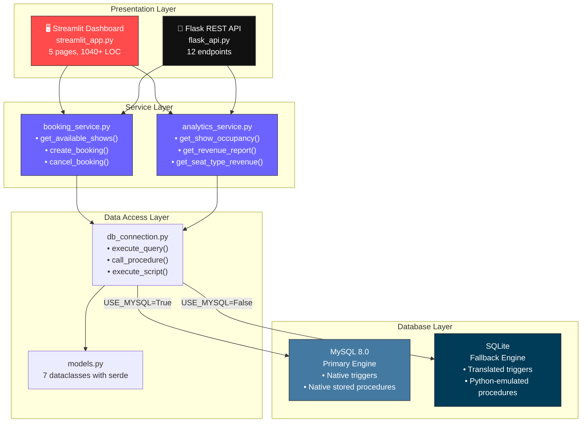
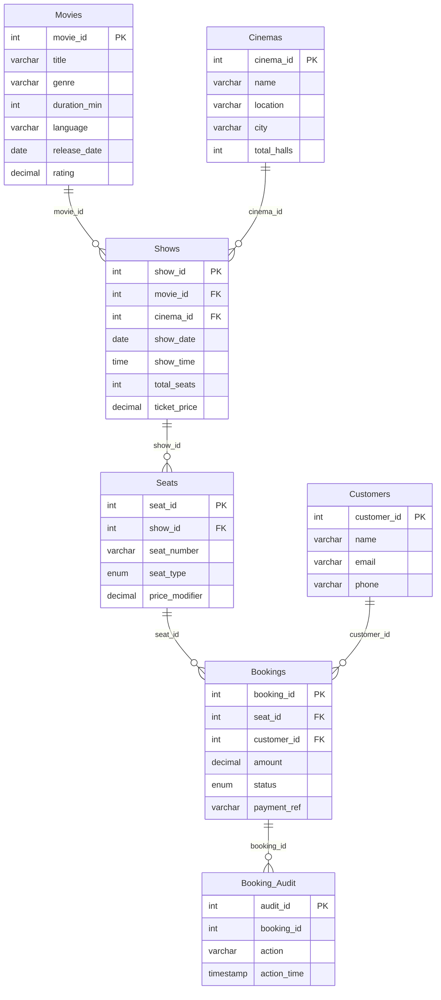
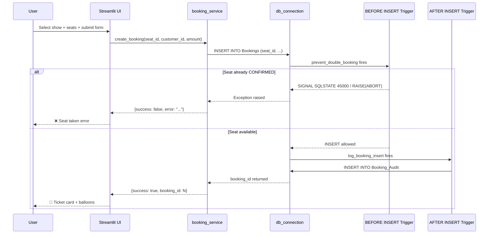
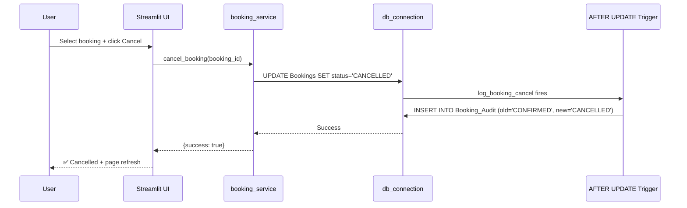
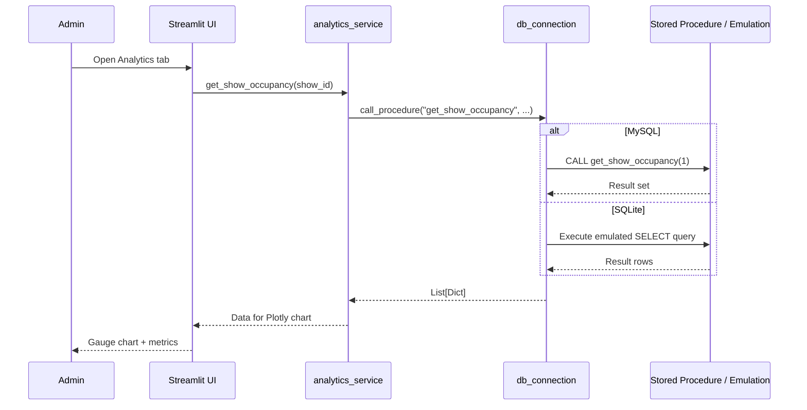

# CineBook — Architecture Deep Dive

## System Architecture

## Database ER Diagram

## Data Flow: Booking a Ticket

## Data Flow: Cancellation

## Data Flow: Analytics

## Key Design Decisions

| Decision | Rationale |
|----------|-----------|
| **Dual DB engine** | MySQL for production with triggers + SPs; SQLite fallback for zero-config demo |
| **BEFORE INSERT trigger** | Database-level enforcement prevents double-booking even with concurrent API calls |
| **Stored procedure emulation** | Python-level SELECT queries mirror MySQL SPs for SQLite compatibility |
| **Single-file Streamlit** | Keeps deployment simple; `if/elif` routing is adequate at 1000 LOC |
| **3NF strict** | No denormalized fields; all joins via FK — proves single-point-of-update |
| **Audit triggers** | Every booking change is logged automatically — no application-level logging needed |
